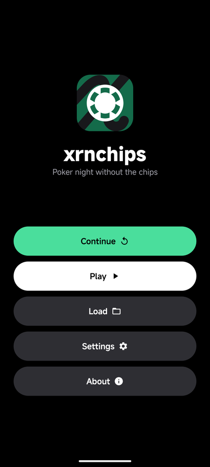
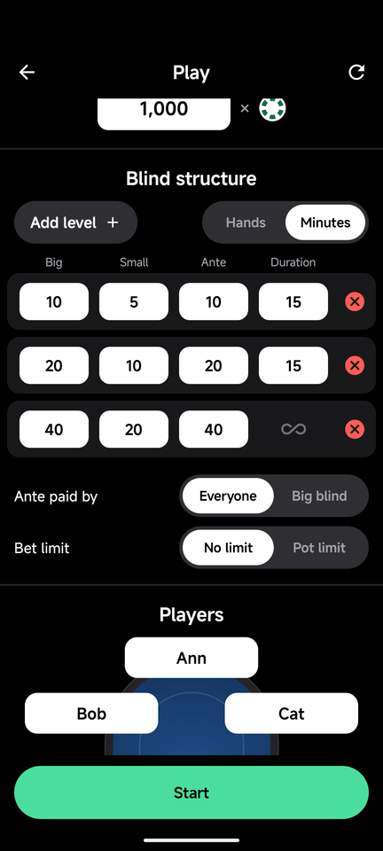
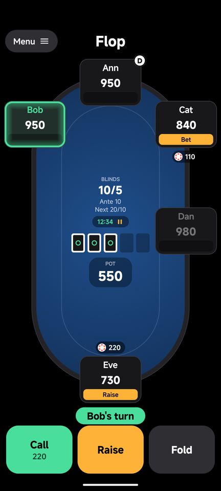
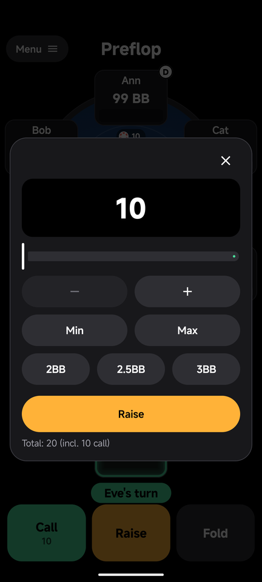
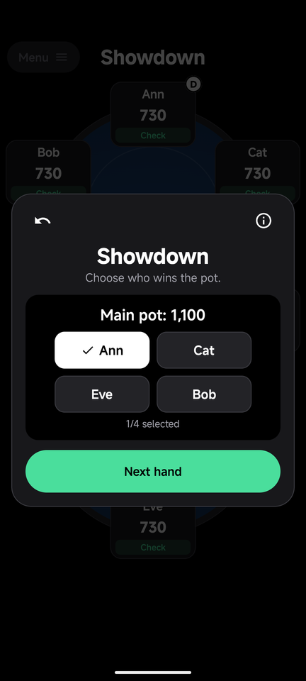
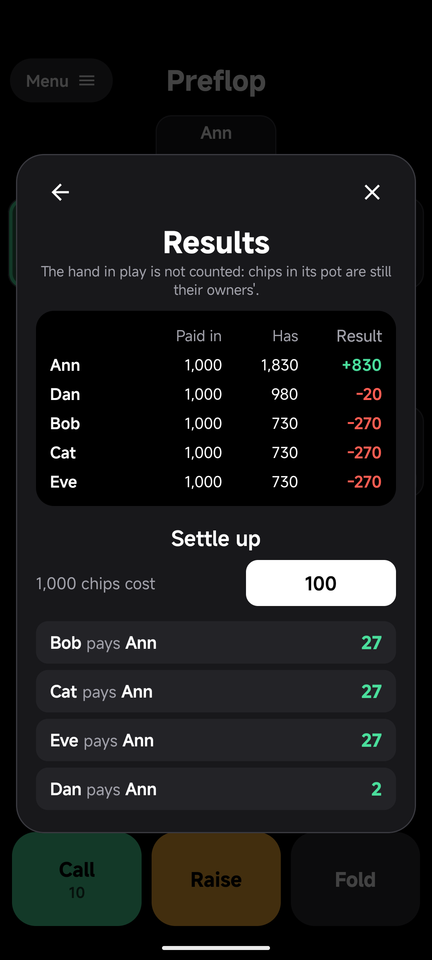

<p align="center">
  
</p>

<h1 align="center">xrnchips</h1>

Poker night without the chips. xrnchips keeps the stacks, blinds, bets and pots of a live Texas
Hold'em game on one Android phone, so the table only needs a deck of cards. The phone is passed
around or left in the middle and each player acts on their turn.

It never sees the cards: at a showdown the table tells it who won each pot. No ads, no accounts, no
network access. Games are saved on the phone.

Kotlin and Jetpack Compose. Minimum Android 8.0.

## What it does

- A game for 2 to 8 players, each at a seat of their choice, with any starting stack.
- A blind structure of up to 20 levels with antes, lasting a number of hands or minutes each.
- No limit or pot limit, with antes from everyone or from the big blind alone.
- Check, call, bet, raise, fold and all-in with the turn order, minimum raises and side pots worked
  out for you. Action buttons have to be held, so a brush of the screen does nothing.
- Mid-game: add chips, buy a late player in, let a player leave, undo any move. A player who goes
  broke buys back in or leaves.
- Accounts for the whole night: what everyone bought and what they hold, and, given the price of a
  stack, who pays whom in the fewest payments.
- An autosave after every move, and saves you make yourself.

[docs/feature-spec.md](docs/feature-spec.md) describes every screen and rule.

## Screenshots

| Start | Play | Table |
| --- | --- | --- |
|  |  |  |

| Raise | Showdown | Results |
| --- | --- | --- |
|  |  |  |

## Build and test

```sh
./gradlew :app:testDebugUnitTest      # unit tests
./gradlew :app:assembleDebug          # app/build/outputs/apk/debug/app-debug.apk
adb install -r app/build/outputs/apk/debug/app-debug.apk
./gradlew :app:assembleRelease        # app/build/outputs/apk/release/app-release.apk
```

The sound effects are generated, not recorded. To change them, edit and rerun
`python3 tools/make_sounds.py` (needs numpy); it rewrites `app/src/main/res/raw/*.wav`.

## Layout

- `app/src/main/java/com/xern/xrnchips/domain`: the rules as pure functions over one state value.
  No Android in here; this is what the unit tests cover.
- `.../data`: settings, the Play screen, the autosave and saved games as JSON files; the sounds.
- `.../ui`: the screens. `TableModel` paces the steps the table takes by itself and keeps what
  Undo can go back to.
- `docs/icon`: the app icon's sources.
- `docs/screenshots`: the pictures above, taken on an emulator at phone size.

## Credits

Uses [MiSans](https://hyperos.mi.com/font) by Xiaomi.

## Docs

- [Feature spec](docs/feature-spec.md): what every screen does and how a hand is run.
- [Status](docs/status.md): what has been tested, and where the app differs from the app it was
  modelled on.
