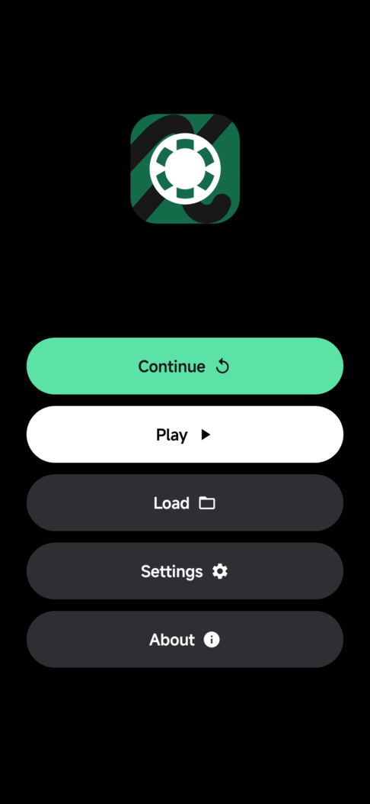
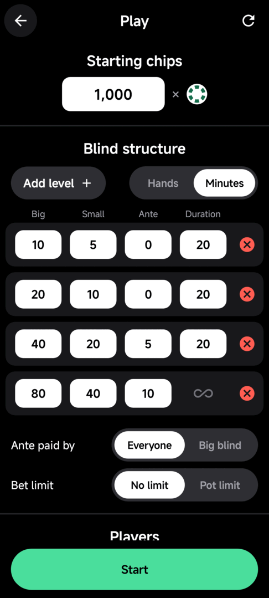
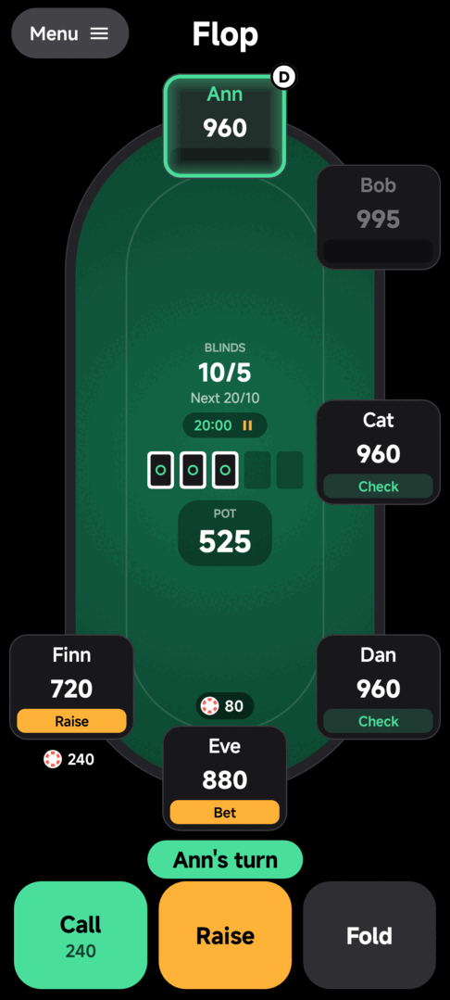
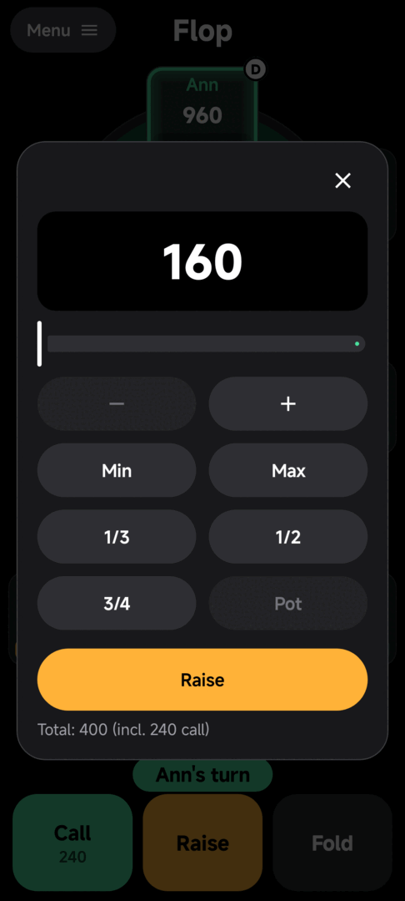
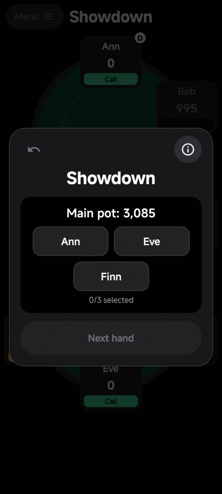
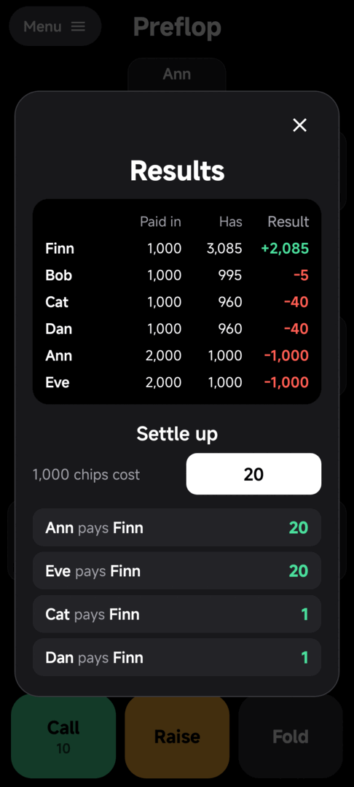

<p align="center">
  
</p>

<h1 align="center">xrnchips</h1>

Poker night without the chips. xrnchips keeps the stacks, blinds, bets and pots of a live Texas
Hold'em game on one Android phone, so the table only needs a deck of cards. The phone is passed
around or left in the middle and each player acts on their turn.

It never sees the cards: at a showdown the table tells it who won each pot. No ads, no accounts, no
network access. Games are saved on the phone.

Kotlin and Jetpack Compose. Minimum Android 8.0. Version 0.5.0 (build 7). MIT licence.

## What it does

- **The game:** 2 to 8 players, each at a seat of their choice, with any starting stack. A blind
  structure of up to 20 levels with antes, each lasting a number of hands or minutes; on the clock,
  the time left shows on the table and can be paused. No limit or pot limit, with antes from
  everyone or from the big blind alone.
- **The table:** each seat's stack and what it did this street, the dealer button, the bets in
  front, the pot and the board's five slots, the blinds and the next level, and whose turn it is.
  Stacks can show as chips or as big blinds.
- **Betting:** check, call, bet, raise, fold and all-in with the turn order, minimum raises and side
  pots worked out for you; a call or raise never asks for more than someone else still in the hand
  could match. The raise dialog takes a typed amount, a slider, − and +, Min and Max, and
  shortcuts (2, 2.5 or 3 big blinds before the flop, then ⅓, ½, ¾ or the whole pot).
  Action buttons have to be held (0.4 seconds by default), so a brush of the screen does nothing;
  a double tap can be allowed too.
- **The showdown:** the app never sees the cards, so it lists each pot with who can win it and the
  table taps the winners; a split pot's odd chip goes to the first winner left of the dealer. The
  hand rankings are a tap away.
- **Mid-game:** add chips, buy a late player in, let a player leave, undo any move. A player who
  goes broke buys back in or leaves.
- **Accounts for the whole night:** what everyone paid in and what they hold, and, given the price
  of a stack, who pays whom in the fewest payments.
- **Saves:** an autosave after every move (Continue on the start screen opens it), and saves you
  make yourself, each with its Undo history, under Load.
- **Settings:** vibration, sound and a soft note on each new turn, the hold time, the raise steps,
  stacks in big blinds, and the felt's colour (green, blue, red or slate).

[docs/feature-spec.md](docs/feature-spec.md) describes every screen and rule.

## Screenshots

Drawn with `android preview render` from made-up players (Ann, Bob, Cat, Dan, Eve and Finn), at
phone size.

| Start | Play | Table |
| --- | --- | --- |
|  |  |  |
| Continue while an autosave waits, then Play, Load, Settings and About. | Starting chips, the blind levels, the rules, and who sits where. | The flop: bets in front of the players, the pot, and whose turn it is. |

| Raise | Showdown | Results |
| --- | --- | --- |
|  |  |  |
| The amount by slider, steps or shortcut, within the rules. | The table says who won each pot. | Who paid in what, who holds what, and who pays whom. |

## Build and test

```sh
./gradlew :app:testDebugUnitTest      # 40 unit tests
./gradlew :app:assembleDebug          # app/build/outputs/apk/debug/app-debug.apk
adb install -r app/build/outputs/apk/debug/app-debug.apk
./gradlew :app:assembleRelease        # app/build/outputs/apk/release/app-release.apk
android preview render "?:app" --fqn=com.xern.xrnchips.ui.PreviewsKt.StartPreview   # a screen with no phone
```

The tests replay an eight-hand session first played on the app xrnchips is modelled on, and cover
the raise rule, pot limit, side pots, buying back in, the clock, settling up, the Play screen's
fields, saved games and the fonts.

The release build is signed with the build machine's debug key, so it installs over a debug build
and keeps the saved games. CI runs the unit tests, a debug build and lint on every push to `main`
and every pull request.

The sound effects are generated, not recorded. To change them, edit and rerun
`python3 tools/make_sounds.py` (needs numpy); it rewrites `app/src/main/res/raw/*.wav`.

## Layout

- `app/src/main/java/com/xern/xrnchips/domain`: the rules as pure functions over one state value.
  No Android in here; this is what the unit tests cover.
- `.../data`: settings, the Play screen, the autosave and saved games as JSON files; the sounds.
- `.../ui`: the screens. `TableModel` paces the steps the table takes by itself and keeps what
  Undo can go back to.
- `docs/icon`: the app icon's sources.
- `app/src/debug/.../ui/Previews.kt`: screens drawn without a phone, debug builds only.
- `docs/screenshots`: the pictures above.

## Where it differs from Pocket Poker Chips

xrnchips is modelled on Pocket Poker Chips 3.0.0 for Android and follows its screens, flows and
betting rules. It was written from that app's behaviour alone and shares no code, art, sound or
font with it. The main differences:

- **Added:** a player out of chips is asked to buy back in or leave; accounts for the night and
  settling up; pot limit, the big blind ante and stacks in big blinds; Continue from the autosave;
  a working Back button.
- **Different on purpose:** the usual raise rule (a short all-in doesn't reopen the betting); no
  call or raise beyond what another player still in the hand could match; antes as dead money in
  the main pot; the player to act marked harder; the blinds in the middle of the table.
- **Left out:** ads, Remove Ads, Restore Purchase, Feedback, Rate App and the privacy policy link,
  since nothing is sold or collected.

[docs/status.md](docs/status.md) lists every difference and what wasn't checked against it.

## Credits

Uses [MiSans](https://hyperos.mi.com/font) by Xiaomi.

## Docs

- [Feature spec](docs/feature-spec.md): what every screen does and how a hand is run.
- [Status](docs/status.md): what has been tested, and where the app differs from the app it was
  modelled on.
